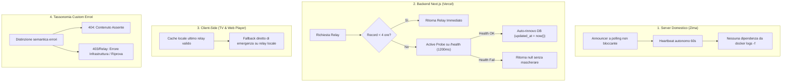

# Blueprint: Architettura di Resilienza Relay & Sistema Custom Error Handling

**Stato:** `in corso`  
**Area:** Relay Home, Player TV webOS, Player Desktop/Mobile, Backend Vercel, Supabase  
**Errore Collegato:** [10-relay-heartbeat-ttl-403-forbidden.md](file:///c:/Users/matti/Documents/TheHustlePlace/doc/errore/10-relay-heartbeat-ttl-403-forbidden.md)

---

## 1. Visione & Obiettivi

Rendere il sistema di streaming completamente **resiliente e auto-riparante**, eliminando i falsi errori 403 e le false indicazioni di contenuto mancante causati dalla scadenza dei timer notturni del relay.

### I 4 Pilastri Architetturali

---

## 2. Dettaglio Tecnico delle Modifiche

### 2.1 Backend: Active Probe e Auto-Rinnovo (`lib/db/vixsrc-relay.ts`)
- Quando `getHomeRelayConfig()` o `getAnnouncedRelayUrl()` non trovano record entro 4 ore, non restituiscono subito `null`.
- Se esiste un record più vecchio (fino a 7 giorni), lanciano un `fetch` leggero verso `${url}/health` con timeout di 1200ms.
- Se l'endpoint risponde con `{ ok: true }`, il backend esegue automaticamente `UPDATE vixsrc_home_relay SET updated_at = now() WHERE id = 1`.
- In questo modo, l'arrivo della prima richiesta utente della giornata "risveglia" l'accettazione del relay nel database a costo zero.

### 2.2 Server Zima: Announcer Robusto (`zima/vixsrc-relay/announce.py`)
- Sostituzione del meccanismo bloccante `docker logs -f` con un ciclo a polling leggero (`docker logs --tail 100`).
- Estrazione garantita del dominio `trycloudflare.com` anche in assenza di traffico video.
- Invio del ping POST ogni 60 secondi con gestione delle eccezioni e timeout sicuri.

### 2.3 Client: Cache Locale Ultimo Relay Funzionante (`public/tv-os.html` e `lib/player-resolve.ts`)
- Salvare in `localStorage` l'ultimo URL e token validi ricevuti da `/api/player/relay`.
- Qualora `/api/player/relay` fallisca o ritorni `null`, effettuare un tentativo rapido (1500ms) verso l'ultimo URL noto prima di tentare il fallback pubblico Vercel.

### 2.4 Error Handling & UI Messaging (`components/vixsrc-embed-player.tsx` e `public/tv-os.html`)
- Separare la gestione dell'errore di indisponibilità film dal blocco provider:
  - Se l'errore contiene `403` o `API VixSrc non disponibile`, mostrare:
    > *"Impossibile contattare la sorgente video. Verifica la connessione del relay domestico."*
  - Se l'errore contiene `404`, `non trovato` o `senza embed`, mostrare:
    > *"Film o episodio non disponibile sul catalogo VixSrc."*

---

## 3. Piano di Rilascio e Verifica
1. Modifica `lib/db/vixsrc-relay.ts` (Active Probe).
2. Modifica `zima/vixsrc-relay/announce.py` (Polling non bloccante).
3. Modifica `lib/player-resolve.ts` e `public/tv-os.html` (Local Cache & Probe).
4. Aggiornamento messaggistica UI in `components/vixsrc-embed-player.tsx`.
5. Esecuzione test suite Vitest (`npm run test`).
