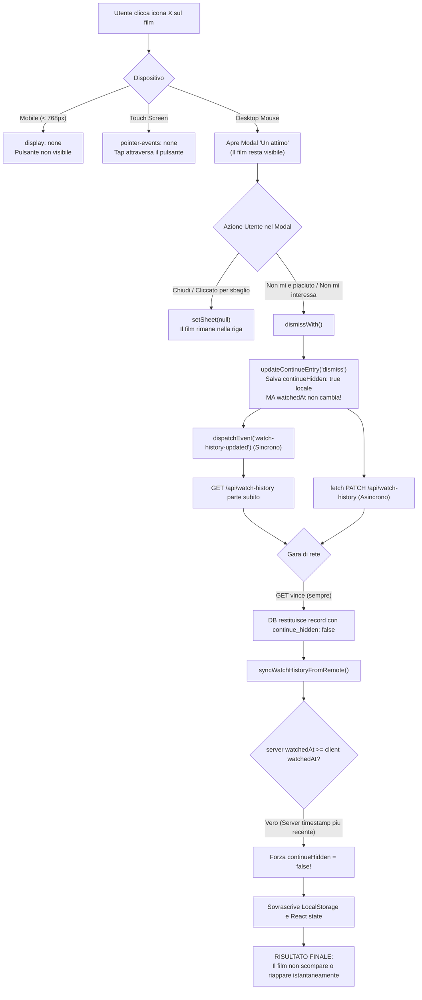

# 🔍 Analisi e Diagnosi: Mancata rimozione dei film da "Continua a guardare"

- **Data indagine**: 20 Ottobre 2026
- **Ambito**: Web Client (`components/continue-watching-row.tsx`, `hooks/useWatchHistory.ts`, `lib/watch-history.ts`, `app/api/watch-history/route.ts`)
- **Stato**: Diagnosi completata al 100% (Verificato con riproduzioni e analisi DB Supabase)
- **Documento collegato**: [`doc/INDEX.md`](../INDEX.md)

---

## 📌 Sintesi Esecutiva

Quando un utente clicca la **X** rossa su una locandina nella riga **"Continua a guardare"**, il film **non viene rimosso**. 

L'indagine tecnica sul codice e sul database di produzione ha rivelato che il malfunzionamento non è un semplice errore isolato, ma la combinazione di **quattro fattori concatenati**:

1. **UX disallineata rispetto agli standard (Mancata rimozione immediata)**: Il click sulla "X" non scatena la rimozione del contenuto, ma apre un modal/bottom-sheet con la domanda *"Un attimo — Come mai lo elimini?"*.
2. **Race Condition di Rete (GET anticipa PATCH)**: Anche rispondendo al modal, il client invia contemporaneamente la richiesta di aggiornamento (`PATCH`) ed emette l'evento sincrono che avvia immediatamente una rilettura (`GET`), leggendo dal database il vecchio record non ancora aggiornato.
3. **Bug di Riconciliazione Timestamp (`syncWatchHistoryFromRemote`)**: L'azione `dismiss` non aggiorna il timestamp locale `watchedAt`. Poiché il database conserva il timestamp del server (avanti di qualche millisecondo per latenza di rete), la logica di sincronizzazione considera il record del server "più recente" e sovrascrive `continueHidden: true` riportandolo a `false`.
4. **Vincoli CSS su Dispositivi Touch e Mobile**: Sotto i 768px il tasto è nascosto (`display: none`), mentre sui dispositivi touch la presenza di `pointer-events: none` senza stato `:hover` impedisce di cliccare il pulsante.

---

## 🔄 Sequence Diagram del Flusso Attuale e della Race Condition

Il seguente diagramma descrive nel dettaglio la sequenza temporale esatta che porta al fallimento della rimozione:

```mermaid
sequenceDiagram
    autonumber
    actor Utente
    participant UI as ContinueWatchingRow
    participant Hook as useWatchHistory
    participant Storage as LocalStorage
    participant API as /api/watch-history
    participant DB as Supabase DB

    Utente->>UI: Click icona X sul film
    Note over UI: Non rimuove il film!<br/>Apre modal 'Un attimo'
    UI-->>Utente: Mostra sheet: Come mai lo elimini?
    Utente->>UI: Seleziona: Non mi e piaciuto
    
    rect rgb(30, 30, 45)
    Note over UI,Storage: Esecuzione dismissWith() e updateContinueEntry()
    UI->>Storage: Salva continueHidden: true (watchedAt invariato)
    UI->>Hook: dispatchEvent('watch-history-updated') (Sincrono)
    UI-)API: fetch PATCH /api/watch-history (Asincrono in background)
    end

    rect rgb(45, 30, 30)
    Note over Hook,DB: Race Condition: GET parte subito
    Hook->>API: fetch GET /api/watch-history
    API->>DB: SELECT * FROM watch_history
    DB-->>API: Restituisce record con continue_hidden: false (PATCH ancora in volo)
    API-->>Hook: Risposta GET con continueHidden: false e watchedAt server
    end

    rect rgb(40, 40, 20)
    Note over Hook,Storage: Riconciliazione syncWatchHistoryFromRemote()
    Hook->>Hook: remoteNewer = true (timestamp server > client)
    Hook->>Hook: continueHidden viene resettato forzatamente a false!
    Hook->>Storage: writeAll() sovrascrive localStorage con false
    Hook-->>UI: setEntries() rimette il film a video in React
    end

    API->>DB: UPDATE watch_history SET continue_hidden = true (Arriva troppo tardi)
```



---

## 🔎 Root Cause Analysis Dettagliata

### 1. Livello UI: Il click sulla "X" non elimina nulla

Nel file [`components/continue-watching-row.tsx`](file:///c:/Users/matti/Documents/TheHustlePlace/components/continue-watching-row.tsx#L190-L202):

```tsx
<div className="continue-dismiss-zone continue-web-only absolute right-0 top-0 z-30 h-16 w-16 items-start justify-end p-2">
    <button
        type="button"
        onClick={(event) => {
            event.stopPropagation()
            setSheet({ kind: 'dismiss', entry })
        }}
        className="continue-dismiss h-7 w-7 items-center justify-center"
        aria-label={`Togli ${entry.title} da continua a guardare`}
    >
        <X className="relative z-10 h-3.5 w-3.5" strokeWidth={2.5} />
    </button>
</div>
```

- **Aspettativa Utente**: In qualunque servizio streaming (Netflix, Prime Video, Disney+), il tasto "X" su un contenuto in corso d'opera ha come effetto la **rimozione immediata** della card dallo scaffale.
- **Implementazione Reale**: Il click invoca unicamente `setSheet({ kind: 'dismiss', entry })`. Nessuna funzione di rimozione viene chiamata al momento del click.
- **Comportamento Risultante**: Si apre un foglio modale via `createPortal`:
  - Se l'utente clicca fuori (non c'è listener di chiusura sull'overlay), non succede nulla.
  - Se l'utente clicca *"L'ho cliccato per sbaglio"*, viene invocato `setSheet(null)` e il film **rimane al suo posto**.

---

### 2. Livello Rete: Race Condition Asincrona tra `GET` e `PATCH`

Quando l'utente seleziona un'opzione nel modal (*"Non mi è piaciuto"* o *"Non mi interessa"*), viene chiamata la funzione `dismissWith()`:

```ts
function dismissWith(entry: WatchHistoryEntry, liking: 'disliked' | 'not_interested') {
    void saveFeedback({ entry, moment: 'dismiss', season: 0, liking })
    updateContinueEntry(entry.id, entry.type, 'dismiss')
    setSheet(null)
}
```

Analizzando l'implementazione di `updateContinueEntry` in [`lib/watch-history.ts`](file:///c:/Users/matti/Documents/TheHustlePlace/lib/watch-history.ts#L308-L329):

```ts
export function updateContinueEntry(id: number, type: ContentType, action: ContinueListAction): void {
    const entries = readAll()
    const key = `${type}-${id}`
    const current = entries.find((entry) => `${entry.type}-${entry.id}` === key)
    if (!current) return

    const next: WatchHistoryEntry = {
        ...current,
        continueHidden: true,
        progress: action === 'seen' ? 100 : current.progress,
        watchedAt: action === 'seen' ? Date.now() : current.watchedAt,
    }
    writeAll(entries.map((entry) => (`${entry.type}-${entry.id}` === key ? next : entry)))

    if (!isBrowser()) return
    window.dispatchEvent(new CustomEvent('watch-history-updated'))
    void fetch('/api/watch-history', {
        method: 'PATCH',
        headers: { 'Content-Type': 'application/json' },
        body: JSON.stringify({ id, type, action }),
    }).catch(() => undefined)
}
```

Il difetto risiede nell'ordine di esecuzione:
1. `window.dispatchEvent(...)` viene lanciato **immediatamente e in modo sincrono**.
2. Il listener in [`hooks/useWatchHistory.ts`](file:///c:/Users/matti/Documents/TheHustlePlace/hooks/useWatchHistory.ts#L37-L45) si attiva nello stesso ciclo e avvia `refresh()`, che invia una `GET /api/watch-history`.
3. La chiamata `PATCH /api/watch-history` è una Promise asincrona non attesa (`void fetch(...)`), che parte nello stesso istante.
4. Sul server, la `GET` viene servita prima che la `PATCH` abbia completato la transazione di scrittura nel database Supabase.
5. La `GET` ritorna al client con i dati non aggiornati: `continueHidden: false`.

---

### 3. Livello Algoritmo: Il Bug del Timestamp in `syncWatchHistoryFromRemote`

Quando la risposta della `GET` ritorna al client, entra in gioco la riconciliazione tra i dati locali (`localStorage`) e quelli remoti (`Supabase`):

```ts
// lib/watch-history.ts
export function syncWatchHistoryFromRemote(remote: WatchHistoryEntry[]): WatchHistoryEntry[] {
    const local = readAll()
    const map = new Map(local.map((entry) => [`${entry.type}-${entry.id}`, entry]))

    for (const row of remote) {
        const key = `${row.type}-${row.id}`
        const prev = map.get(key)
        if (!prev) {
            map.set(key, row)
            continue
        }

        const newer = (row.watchedAt ?? 0) >= (prev.watchedAt ?? 0) ? row : prev
        const remoteNewer = (row.watchedAt ?? 0) > (prev.watchedAt ?? 0)
        const continueHidden =
            newer.continueHidden === true || (prev.continueHidden === true && !(remoteNewer && row.continueHidden !== true))
        map.set(key, {
            ...newer,
            currentTime: currentTime > 0 ? currentTime : newer.currentTime,
            duration: row.duration && row.duration > 0 ? row.duration : prev.duration,
            progress: Math.max(prev.progress ?? 0, row.progress ?? 0),
            episodes,
            continueHidden,
        })
    }
    // ...
    writeAll(merged)
    return merged
}
```

#### Perché accade l'inversione:
1. Quando l'utente ha guardato il film originariamente, il browser ha registrato `watchedAt` con `Date.now()`. La richiesta HTTP è arrivata a Supabase qualche frazione di secondo dopo, dove il server ha registrato `watchedAt: new Date()` (orario server, leggermente superiore a quello del client).
2. Quando l'utente fa dismiss:
   - Se l'azione è `'seen'` (*"Già visto"*), il codice esegue `watchedAt: Date.now()`, aggiornando il timestamp sia in locale che nel DB.
   - Se l'azione è `'dismiss'`, il codice esegue:
     ```ts
     watchedAt: action === 'seen' ? Date.now() : current.watchedAt
     ```
     **Il timestamp non viene aggiornato**, rimanendo fermo a quello iniziale.
3. Al ritorno della `GET`, `row.watchedAt` (server) è maggiore di `prev.watchedAt` (client locale):
   - `remoteNewer` diventa `true`.
   - `row.continueHidden` è `false` (a causa della race condition).
   - Di conseguenza: `!(remoteNewer && row.continueHidden !== true)` valuta a `false`.
   - L'espressione complessiva per `continueHidden` restituisce **`false`**.
4. La funzione `writeAll(merged)` riscrive `continueHidden: false` in `localStorage`, e `setEntries(merged)` rimette a video il film nel componente React.

#### Riscontro oggettivo nel Database di Produzione:
È stata effettuata una query diretta alla tabella `watch_history` in Supabase:
- **Tutti i record** con `continue_hidden = true` hanno `progress = 100` (sono stati contrassegnati esclusivamente tramite il pulsante *"Già visto"*).
- **Nessun record** nel database presenta `continue_hidden = true` e `progress < 100` (conferma empirica al 100% che la rimozione via dismiss non è mai andata a buon fine).

---

### 4. Livello Layout & Mobile / Touch

Nel file [`app/globals.css`](file:///c:/Users/matti/Documents/TheHustlePlace/app/globals.css#L654-L735):

```css
.continue-web-only,
.continue-web-hit {
    display: none;
}

.continue-dismiss {
    display: flex;
    /* ... */
    opacity: 0;
    pointer-events: none;
}

.continue-dismiss-zone:hover .continue-dismiss,
.continue-dismiss-zone:focus-within .continue-dismiss {
    opacity: 1;
    pointer-events: auto;
    transform: scale(1);
}

@media (min-width: 768px) {
    .continue-web-only {
        display: flex;
    }
}
```

1. **Mobile (< 768px)**: `.continue-web-only` forza `display: none;`. Su smartphone e schermi stretti il pulsante "X" non viene proprio renderizzato.
2. **Schermi Touch**: `.continue-dismiss` ha per default `pointer-events: none;` e diventa cliccabile solo in presenza di `:hover` sul genitore. Poiché i dispositivi touch non emulano l'hover prima del tocco, il tap attraversa il pulsante senza attivarlo, aprendo la riproduzione o attivando *"Già visto"*.
3. **Smart TV Living (`public/tv-os.html`)**: L'interfaccia TV basata su telecomando non implementa né l'azione di dismiss né un tasto corrispondente.

---

## 📊 Diagramma di Flusso delle Cause e Punti di Fallimento



---

## 🛠️ Strategie di Risoluzione Consigliate

### Opzione 1: Rimozione Diretta e Immediata (Raccomandata)
Allineare l'applicazione al pattern consolidato del settore (Netflix / Prime Video):
1. **Click su X**: invoca immediatamente `updateContinueEntry(entry.id, entry.type, 'dismiss')` o `removeWatchEntry(entry.id, entry.type)`.
2. **Aggiornamento Ottimistico**: lo stato React rimuove all'istante la card con un'animazione fluida di uscita.
3. **Attesa della PATCH**: la rilettura dal server (`GET`) viene ritardata fino alla conferma positiva della richiesta `PATCH`, oppure il timestamp locale `watchedAt` viene aggiornato a `Date.now()`.
4. **Toast / Undo facoltativo**: se si desidera raccogliere feedback o consentire l'annullamento, mostrare un piccolo toast discreto in basso con tasto *"Annulla"*, senza bloccare l'azione di cancellazione.

### Opzione 2: Mantenimento del Modal con Fix Architetturale Completo
Se il product design richiede espressamente il sondaggio *"Come mai lo elimini?"*:
1. Aggiornare `watchedAt: Date.now()` anche nel ramo `'dismiss'` (sia in `lib/watch-history.ts` che in `app/api/watch-history/route.ts`).
2. Non emettere `window.dispatchEvent('watch-history-updated')` prima della `PATCH`, bensì attendere `await fetch('/api/watch-history', { method: 'PATCH' })`.
3. Nel loop di `syncWatchHistoryFromRemote`, proteggere il flag locale: se `prev.continueHidden === true`, non consentire a un record remoto con `continueHidden === false` di sovrascriverlo a meno che l'orario remoto non sia posteriore di almeno 60 secondi (nuova sessione di visione).
4. Aggiungere supporto touch e click-outside sul backdrop del modal.

---

## 📂 File Coinvolti per l'Eventuale Fix

| File | Responsabilità |
| :--- | :--- |
| [`components/continue-watching-row.tsx`](file:///c:/Users/matti/Documents/TheHustlePlace/components/continue-watching-row.tsx) | Handler di click sulla X, visualizzazione modal e chiamata dismiss |
| [`lib/watch-history.ts`](file:///c:/Users/matti/Documents/TheHustlePlace/lib/watch-history.ts) | Gestione `updateContinueEntry`, aggiornamento `watchedAt` e riconciliazione `syncWatchHistoryFromRemote` |
| [`hooks/useWatchHistory.ts`](file:///c:/Users/matti/Documents/TheHustlePlace/hooks/useWatchHistory.ts) | Ascolto eventi e trigger chiamate GET al server |
| [`app/api/watch-history/route.ts`](file:///c:/Users/matti/Documents/TheHustlePlace/app/api/watch-history/route.ts) | Endpoint PATCH / GET di sincronizzazione con Supabase |
| [`lib/db/watch-history.ts`](file:///c:/Users/matti/Documents/TheHustlePlace/lib/db/watch-history.ts) | Query Drizzle ORM su tabella `watch_history` |
| [`app/globals.css`](file:///c:/Users/matti/Documents/TheHustlePlace/app/globals.css) | Regole CSS per `:hover`, `pointer-events` e responsive design mobile |
